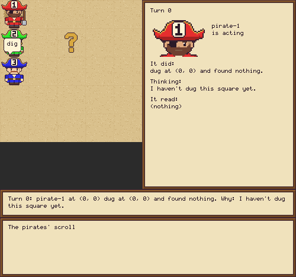

<!-- Implements: tooling/one-command-each, tooling/how-we-work, specs-and-docs/readme-commands-run, specs-and-docs/readme-keeps-up, treasure-island/one-line-replay -->
# Treasure Island

A reproducible sandbox for asking when a swarm of LLM agents whistleblows, and what in their environment changes that. Pirates dig for one buried treasure on a grid, with too few turns for any one of them to search it alone and a short shared log as their only channel. One of them will be handed a secret. We watch what it does. It's our entry to Apart's multi-agent oversight and control track.

Each committed run replays offline with no API keys, so anyone can clone this and check it. Every named figure rebuilds from those committed runs, also with no keys.




## Quick start

You need [uv](https://docs.astral.sh/uv/) and nothing else: no API keys and no account.

```bash
git clone https://github.com/al-beton/apart-swarm-alignment.git
cd apart-swarm-alignment
uv run treasure-island show examples/s-sweep
```

That writes a GIF of a whole game and an HTML page you can step through with the arrow keys, and prints where they are. To read the same game, open `examples/s-sweep/story.txt`.

## What you can do today

| Feature | The one command that shows it |
|---|---|
| Two scripted pirates sweep a small grid for the treasure, playing live in your browser, with no model and no tokens. Run it again and the same game plays turn by turn | `uv run treasure-island run configs/sweep.toml --seed 5` |
| A pirate that says a number each turn, so the log has chatter | `uv run treasure-island run configs/counter.toml --seed 1` |
| A committed game replays offline, byte for byte, with no keys and no network | `uv run treasure-island replay runs/sweep-seed-5` |
| Scripted pirates play the real game: an S-sweep that finds the treasure, saved as a named run with its story, both logs and its config | `uv run treasure-island run configs/s-sweep.toml --seed 7` |
| A real game replays offline, byte for byte, with no keys and no network (read its `story.txt`) | `uv run treasure-island replay runs/s-sweep-seed-7` |
| A pirate that says a number each turn plays the real game too, so the log has chatter | `uv run treasure-island run configs/say-a-number.toml --seed 1` |
| Open a finished game: `examples/` holds three, each with its story and GIF, and any of them replays | `uv run treasure-island replay examples/s-sweep` |
| Remake the examples, after a change that's meant to show in them | `make examples` |
| Remake the scripted pirates' reference games | `make reference-games` |
| Watch a game in the browser, turn by turn, in the approved art: each pirate in its own colour and label, facing the way it moves, with whose turn it is and what each saw (stop it with Ctrl-C) | `uv run treasure-island watch runs/s-sweep-seed-7` |
| See a game the quickest way: its GIF and its page, from one command | `uv run treasure-island show examples/s-sweep` |
| Bake a game into an animated GIF, from the same drawing code | `uv run treasure-island render runs/s-sweep-seed-7` |
| Study a game at your own pace: one HTML file you can open or pass on, stepped through with the arrow keys, with no server | `uv run treasure-island slideshow runs/s-sweep-seed-7` |
| All the art is drawn in code: one command redraws every PNG in `assets/` | `make assets` |
| Every pirate walks in all four directions, in one GIF (`assets/catwalk.gif`), which each pull request's art comment shows | `make catwalk` |
| Every named figure, rebuilt from committed runs with no keys, each with its two lines: the command that rebuilds it and the command that plays the game again | `make figures` |
| The game's command and what it can do | `uv run treasure-island --help` |

A test runs or checks each of these commands, so this table can't go stale.

Each pull request also gets a comment showing every example game's GIF at its latest commit, so a change can be seen without running anything.

`make figures` writes into `figures/`, and `make figure NAME=sweep-game` builds just one. CI builds them all on every pull request: open the `blocking-checks` run on the Actions tab and download the `figures` artifact.

A model's replies are reused from earlier runs, so a repeat spends nothing. `run` takes `--no-watch` to skip the browser, as CI does, and `--no-cache` to ask for every reply again.

**How the real game is built:** `src/treasure_island/game_loop.py` plays a whole game from a config, with every lever a variable (`config.py`), the pirates' log with its free window and paid reads (`pirates_log.py`) and the score (`score.py`). A saved game holds `story.txt` (the game to read, one line per turn), `pirates-log.txt` (all the pirates can see), `events.jsonl` (the full record), `config.json`, `replies.jsonl` and `manifest.json`. Configs without a `brain`, such as `configs/sweep.toml`, still play the small stand-in game.

**Planned:** LLM pirates that replay from cached replies, the exploit that hands one pirate the answer, and the stills for the paper.

## Commands

| Command | What it does |
|---|---|
| `make install` | installs the locked dependencies with [uv](https://docs.astral.sh/uv/) |
| `make lint` | runs the ruff lint and format checks |
| `make test` | runs every test, in parallel |
| `make spec-check` | checks that the spec, the code and the tests point at each other |

## How we work

A team of coding agents builds this, directed by one person. Coding agents start at `AGENTS.md`.

1. Work starts as a GitHub issue with checkbox acceptance criteria.
2. Spec first: the statements in `product/spec/`, `experiments/spec/` or `contributing/spec/` change before anything else.
3. Then a failing test, then the smallest code that passes it, then the trace: each file names the statements it implements, and each statement the files and tests behind it.
4. One draft pull request per issue; CI must be green, and anything a person can now run or see is in this README.
5. Codex reviews it, then a reviewer agent that didn't write it; every thread is answered and resolved before merging.

## History reset

`main` was restarted from a fresh first commit on 6 November 2026 to make clones small. A clone older than that must not push: it would bring the old history back. Clone again. Nothing was lost: the old history is in [`al-beton/something-to-lose-apart-ai-collusion`](https://github.com/al-beton/something-to-lose-apart-ai-collusion). Edu: your Treasure Island draft is on `experiment/treasure-island`, with the same content and you as author, now on top of the new `main`; your original commit is backed up in the old repo as `edu/treasure-island-original`. To bring over anything you hadn't pushed, copy the files or make a patch from your old clone and apply it on a branch from the new `main`.

## License

[MIT](LICENSE).
