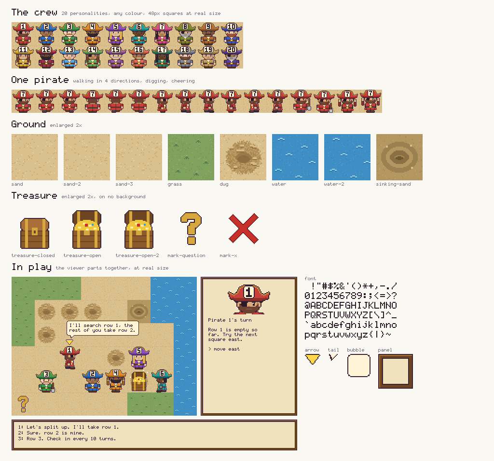

<!-- Implements: assets/plain-files, specs-and-docs/folder-guides -->
# Assets

All the game's art: plain PNG files any renderer can load, and the Python that draws them. `make assets` redraws everything, and a test fails if a committed image doesn't match the code.



## Sizes

A square is 48x48, so a 10x10 board is 480px at real size. Scale by whole numbers only, with nearest-neighbour, or the pixels blur. At half size the labels stop being readable, so a paper figure should crop the board rather than shrink it.

## Files

| Path | Size | What |
|---|---|---|
| `pirates/pirate-01.png` to `pirate-20.png` | 144x288 | One crew member, labelled with its number, in that number's colour and personality. Columns are frames, rows are `down`, `up`, `right`, `left`, `dig`, `cheer`. |
| `tiles/sand.png`, `sand-2.png`, `sand-3.png` | 48x48 | Sand. Mix the three so the ground doesn't look stamped; each has a faint dotted top and left edge, so squares can be counted. |
| `tiles/grass.png` | 48x48 | Grass, walkable like sand, there to break up the ground. |
| `tiles/dug.png` | 48x48 | A dug square: ruffled, and still walkable. |
| `tiles/water.png`, `water-2.png` | 48x48 | Water, which can't be crossed. Alternate the two to animate it. |
| `tiles/sinking-sand.png` | 48x48 | Sinking sand, for hidden terrain once it's found. |
| `treasure/treasure-closed.png` | 48x48 | The chest, shut. Transparent background. |
| `treasure/treasure-open.png`, `treasure-open-2.png` | 48x48 | The chest, open. Alternate the two to make it sparkle. |
| `treasure/mark-question.png`, `mark-x.png` | 48x48 | The marks on the treasure square: `?` from the start, `X` once it's dug up. |
| `ui/font.png` | 96x60 | Printable ASCII from space, 16 across, in 6x10 cells. |
| `ui/bubble.png` | 24x24 | Speech bubble nine-slice, with 8px cells. |
| `ui/bubble-tail.png` | 12x8 | Goes under the bubble, pointing at the speaker. |
| `ui/panel.png` | 36x36 | Side panel and log frame nine-slice, with 12px cells. |
| `ui/turn-arrow.png` | 16x12 | Floats above the pirate whose turn it is. |
| `sheet.png` | 1024x956 | All of the above on one page. |

## Walking

Loop frames 0, 1, 0, 2 of a row. `dig` and `cheer` have two frames each, in columns 0 and 1, and an empty third column.

## Drawing from Python

For a colour or label the PNGs don't have, or a bubble that fits its text:

```python
from assets.pirates import pirate, portrait
from assets.ui import panel, speech_bubble
from assets.font import draw_text

pirate(5, "#2f6fc0", "12", "right", 1)  # personality, any RGB, label, pose, frame
portrait(5, "#2f6fc0", "12")  # 96x64 head for the side panel
speech_bubble("I'll search row 1.")  # sized to its text, tail included
panel(200, 288)  # any size of at least 24x24
```

A label is up to two letters or digits, and anything else raises `ValueError`. A personality is 1 to 20; to give a whole crew one look, pass the same personality with different colours.

## Several pirates on one square

Sprites fill their square, so pirates sharing one hide each other's labels. A renderer should fan them out by a few pixels, keeping each blob visible.
